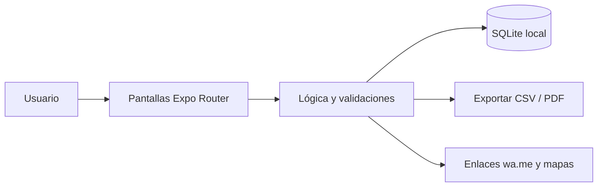

<div align="center">


# CosechaCuenta

**Cuaderno digital del pequeño agricultor: parcelas, campañas, costos, jornales, cosecha y costo por quintal.**

[](LICENSE)
[](https://github.com/LuisRocha2080/CosechaCuenta/actions/workflows/ci.yml)


[Vista rápida](#vista-rápida) · [Características](#características) · [Stack](#stack) · [Roadmap](#roadmap) · [Modelo comercial](#modelo-comercial) · [Inicio rápido](#inicio-rápido) · [Contribuir](#contribuir)

</div>

---

## Vista rápida

| | |
|---|---|
| **Para quién** | Pequeños y medianos agricultores, cooperativas familiares y técnicos de campo |
| **Problema** | El agricultor vende la cosecha sin saber cuánto gastó en semilla, insumos y jornales, y no puede comparar una campaña con otra ni negociar un precio mínimo. |
| **Solución** | App móvil que funciona sin internet y guarda todo en el teléfono. |
| **Costo de licencias** | Bs 0: Expo, React Native, SQLite y TypeScript son de código abierto. |

## Características

- Parcelas con superficie y cultivo actual.
- Campañas por parcela: siembra, labores y cosecha.
- Gastos por categoría: semilla, abono, agroquímicos, jornales, maquinaria y transporte.
- Cosechas con cantidad, unidad (qq, arroba, kg) y precio de venta.
- Costo por unidad cosechada y utilidad por hectárea.
- Tareas con fecha (riego, fumigación, deshierbe) y recordatorio local.

Sin servidores, sin suscripciones obligatorias y sin servicios de pago: todos los datos viven en el dispositivo (SQLite).

## Stack

| Capa | Tecnología |
|---|---|
| App | React Native + Expo (TypeScript) |
| Datos | SQLite local (`expo-sqlite`) |
| Navegación | Expo Router |
| Pruebas | Jest + `tsc --noEmit` |
| Distribución | APK directo / EAS Build local |

### Modelo de datos

- `parcelas` (id, nombre, hectareas, ubicacion, cultivo_actual)
- `campanas` (id, parcela_id, cultivo, fecha_siembra, fecha_cosecha, estado)
- `gastos_campana` (id, campana_id, categoria, monto, fecha, nota)
- `cosechas` (id, campana_id, fecha, cantidad, unidad, precio_unitario, comprador)
- `tareas` (id, campana_id, descripcion, fecha_prevista, hecha)

Detalle completo: [docs/DATOS.md](docs/DATOS.md).

## Arquitectura



## Roadmap

1. Base y navegación
2. Parcelas y campañas
3. Gastos y cosecha
4. Costos y comparativo
5. Tareas y piloto

Detalle fase por fase: [docs/ROADMAP.md](docs/ROADMAP.md) · [docs/SPEC.md](docs/SPEC.md) · [docs/PLANNING.md](docs/PLANNING.md) · [docs/DATOS.md](docs/DATOS.md) · [docs/PANTALLAS.md](docs/PANTALLAS.md) · [docs/PRUEBAS.md](docs/PRUEBAS.md) · [docs/BACKLOG.md](docs/BACKLOG.md) · [docs/NEGOCIO.md](docs/NEGOCIO.md)

## Modelo comercial

- **Cómo se vende:** Pago único bajo o convenios con cooperativas y municipios que capaciten a sus socios.
- **Precio de partida:** Hipótesis a validar: Bs 100–180 pago único.
- **Canal:** Cooperativas agrícolas, ferias agropecuarias y técnicos de extensión.
- **Piloto:** 5 agricultores durante una campaña corta (90 días), midiendo cuántos conocen su costo por quintal al cosechar.

Los precios son hipótesis para validar con clientes reales antes de fijarlos. Ver [docs/NEGOCIO.md](docs/NEGOCIO.md).

## Estructura

```
CosechaCuenta/
├── app/            # Pantallas y rutas (Expo Router)
├── src/
│   ├── db/         # Esquema y consultas SQLite
│   ├── components/ # Componentes reutilizables
│   └── lib/        # Utilidades
├── docs/           # Roadmap, specs, planificación, datos, pantallas, pruebas, backlog
└── .github/        # Plantillas, CI y Dependabot
```

## Inicio rápido

Requisitos: Node.js 20+ y la app Expo Go (o un emulador).

```bash
git clone https://github.com/LuisRocha2080/CosechaCuenta.git
cd CosechaCuenta
npm install
npx expo start
```

> El repositorio está en **fase inicial**: la documentación y la estructura están listas y el código de la app se construye siguiendo el [roadmap](docs/ROADMAP.md).

## Pruebas

```bash
npm test
npx tsc --noEmit
```

## Seguridad

Los datos no salen del teléfono. Para reportar una vulnerabilidad lee [SECURITY.md](SECURITY.md).

## Lo que todavía no existe

- No ofrece pronóstico del clima ni recomendaciones agronómicas.
- Un solo dispositivo por finca en la primera versión.
- Los precios de venta son los que ingresa el usuario.

## Contribuir

Lee la [guía de contribución](CONTRIBUTING.md) y el [código de conducta](CODE_OF_CONDUCT.md). Para dudas, consulta [SUPPORT.md](SUPPORT.md).

## Licencia

Distribuido bajo licencia MIT. Consulta [LICENSE](LICENSE).

---

<div align="center">Hecho por <a href="https://github.com/LuisRocha2080">LuisRocha2080</a></div>
