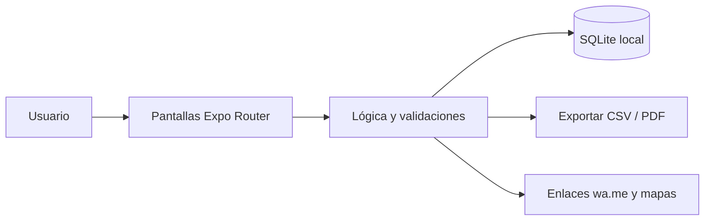

<div align="center">


# 🌽 CosechaCuenta

**Cuaderno digital del pequeño agricultor: parcelas, campañas, costos, jornales, cosecha y costo por quintal.**

[](LICENSE)
[](https://github.com/LuisRocha2080/CosechaCuenta/actions/workflows/ci.yml)


[Inicio rápido](#-inicio-rápido) · [Características](#-características) · [Arquitectura](#️-arquitectura) · [Roadmap](#️-roadmap) · [Pruebas](#-pruebas) · [Limitaciones](#-lo-que-todavía-no-existe) · [Contribuir](#-contribuir)

</div>

El agricultor vende la cosecha sin saber cuánto gastó en semilla, insumos y jornales, y no puede comparar una campaña con otra ni negociar un precio mínimo. **CosechaCuenta** es una app móvil (Android) hecha con React Native + Expo y SQLite local, pensada para pequeños y medianos agricultores, cooperativas familiares y técnicos de campo. Funciona sin internet, sin servidores y sin licencias de pago. **Todavía no es una app lista para usar:** hoy el repositorio contiene la especificación, el plan, el modelo de datos, el diseño de pantallas y la base de configuración; el código de la app llega por fases (ver [Roadmap](#️-roadmap) y [Lo que todavía no existe](#-lo-que-todavía-no-existe)).

## 🎬 Vista rápida

> Aún no hay capturas: la app no está implementada. Las pantallas planificadas están descritas en [docs/PANTALLAS.md](docs/PANTALLAS.md) y se agregarán capturas reales al cerrar la primera fase.

Flujo principal:

```
Parcelas → Campaña → Gastos → Cosecha → Tareas → Comparativo
```

| Pantalla | Qué muestra |
|---|---|
| Parcelas | Lista con cultivo y campaña activa. |
| Campaña | Línea de tiempo con gastos, tareas y cosecha. |
| Gastos | Carga rápida por categoría. |
| Cosecha | Cantidad, destino y precio. |
| Tareas | Pendientes con recordatorio. |
| Comparativo | Costo y utilidad entre campañas de una misma parcela. |

## ✨ Características

| Característica | Detalle |
|---|---|
| Parcelas con superficie | Parcelas con superficie y cultivo actual. |
| Campañas por parcela | Campañas por parcela: siembra, labores y cosecha. |
| Gastos por categoría | Gastos por categoría: semilla, abono, agroquímicos, jornales, maquinaria y transporte. |
| Cosechas con cantidad | Cosechas con cantidad, unidad (qq, arroba, kg) y precio de venta. |
| Costo por unidad | Costo por unidad cosechada y utilidad por hectárea. |
| Tareas con fecha | Tareas con fecha (riego, fumigación, deshierbe) y recordatorio local. |

Todos los datos viven en el dispositivo (SQLite): sin cuentas, sin suscripciones y sin servicios de pago.

## 🏗️ Arquitectura



| Capa | Tecnología |
|---|---|
| App | React Native + Expo (TypeScript) |
| Datos | SQLite local (`expo-sqlite`) |
| Navegación | Expo Router |
| Pruebas | Jest + `tsc --noEmit` |
| Distribución | APK directo / EAS Build local |

**Modelo de datos**

| Tabla | Campos |
|---|---|
| `parcelas` | id, nombre, hectareas, ubicacion, cultivo_actual |
| `campanas` | id, parcela_id, cultivo, fecha_siembra, fecha_cosecha, estado |
| `gastos_campana` | id, campana_id, categoria, monto, fecha, nota |
| `cosechas` | id, campana_id, fecha, cantidad, unidad, precio_unitario, comprador |
| `tareas` | id, campana_id, descripcion, fecha_prevista, hecha |

<details>
<summary>Estructura de carpetas</summary>

```
CosechaCuenta/
├── app/                 # pantallas (Expo Router)
├── src/
│   ├── components/      # componentes de interfaz
│   ├── db/              # esquema y consultas SQLite
│   └── lib/             # lógica y validaciones
├── docs/                # especificación, roadmap, planificación, datos, pantallas, pruebas, backlog y negocio
├── .github/             # CI, CodeQL, Dependabot, plantillas de issues y PR
├── app.json · package.json · tsconfig.json
└── LICENSE · CHANGELOG.md · CONTRIBUTING.md · SECURITY.md · SUPPORT.md
```

</details>

## 🗺️ Roadmap

1. **Base y navegación:** Proyecto Expo + TypeScript, Esquema SQLite
2. **Parcelas y campañas:** CRUD de parcelas, Campañas con estado
3. **Gastos y cosecha:** Gastos por categoría, Registro de cosecha
4. **Costos y comparativo:** Costo por unidad, Utilidad por hectárea, Comparativo entre campañas
5. **Tareas y piloto:** Tareas con recordatorio, PDF de campaña, APK de prueba con 5 agricultores piloto

Detalle fase por fase en [docs/ROADMAP.md](docs/ROADMAP.md). Documentación completa: [SPEC](docs/SPEC.md) · [PLANNING](docs/PLANNING.md) · [DATOS](docs/DATOS.md) · [PANTALLAS](docs/PANTALLAS.md) · [PRUEBAS](docs/PRUEBAS.md) · [BACKLOG](docs/BACKLOG.md) · [NEGOCIO](docs/NEGOCIO.md).

## 💼 Modelo comercial

| Aspecto | Detalle |
|---|---|
| Cómo se vende | Pago único bajo o convenios con cooperativas y municipios que capaciten a sus socios. |
| Precio de partida | Hipótesis a validar: Bs 100–180 pago único. |
| Canal | Cooperativas agrícolas, ferias agropecuarias y técnicos de extensión. |
| Piloto | 5 agricultores durante una campaña corta (90 días), midiendo cuántos conocen su costo por quintal al cosechar. |

Los precios son hipótesis para validar con clientes reales, no resultados medidos.

## 🚀 Inicio rápido

| Requisito | Versión |
|---|---|
| Node.js | 18+ |
| npm | 9+ |
| Android | Expo Go o emulador |

Clona el repositorio y entra a la carpeta.

```bash
git clone https://github.com/LuisRocha2080/CosechaCuenta.git
cd CosechaCuenta
```

Cuando exista el código de la app (fase 1 del roadmap), se instalará y arrancará así:

```bash
npm install
npm start        # Expo; escanea el QR con Expo Go
npm run android  # o en el emulador
```

> **No verificado:** `package.json` todavía no declara dependencias, así que `npm install` y `npm start` aún no levantan una app. Los scripts `npm test` y `npm run typecheck` sí están definidos y pasan sin pruebas todavía.

<details>
<summary>Variables de entorno</summary>

CosechaCuenta no usa variables de entorno ni claves de API: todo funciona en el dispositivo. `.env.example` queda como plantilla vacía por si se agrega una integración (declarala sin valores reales).

</details>

## 🧪 Pruebas

Casos que la suite debe cubrir (definidos en [docs/PRUEBAS.md](docs/PRUEBAS.md)):

- Una sola campaña activa por parcela.
- Costo por unidad con cosecha en qq, arroba y kg.
- Utilidad con ventas parciales.
- Notificación de tarea sin conexión.
- Exportación de una campaña con más de 100 gastos.

Hoy `npm test` corre Jest sin pruebas (`--passWithNoTests`) y `npm run typecheck` ejecuta `tsc --noEmit`. El pipeline de CI y el análisis CodeQL corren en GitHub Actions en cada push y PR a `main`.

## 🔒 Seguridad

**Implementado:** no hay cuentas, contraseñas ni servidores; no se envían datos a terceros. El repositorio tiene activados el reporte privado de vulnerabilidades, Dependabot y la protección de secretos, y hay un workflow de CodeQL.

**Avisos importantes:**

- La base SQLite local no está cifrada: quien tenga acceso al dispositivo desbloqueado puede ver los datos.
- No hay copia de respaldo en la nube; si se pierde el teléfono se pierden los datos (la exportación a CSV/PDF está prevista en el diseño, ver [docs/SPEC.md](docs/SPEC.md)).
- Los problemas de seguridad se reportan según [SECURITY.md](SECURITY.md).

## 🚧 Lo que todavía no existe

- **La app en sí:** el repositorio es la base documental y de configuración; las pantallas, la base de datos y la lógica se construyen fase por fase (ver Roadmap).
- No ofrece pronóstico del clima ni recomendaciones agronómicas.
- Un solo dispositivo por finca en la primera versión.
- Los precios de venta son los que ingresa el usuario.
- Sin capturas de pantalla, sin pruebas automáticas reales y sin APK publicado.
- Los precios y el piloto del modelo comercial son hipótesis sin validar.

## 🤝 Contribuir

¡Las contribuciones son bienvenidas! Leé la [guía de contribución](CONTRIBUTING.md) y el [código de conducta](CODE_OF_CONDUCT.md) antes de abrir un PR. Para bugs o ideas usá las plantillas de issues; los problemas de seguridad se reportan según la [política de seguridad](SECURITY.md). ¿Dudas? Mirá [SUPPORT.md](SUPPORT.md). Los cambios por versión están en el [CHANGELOG](CHANGELOG.md).

## 📄 Licencia

Distribuido bajo la licencia MIT. Ver [LICENSE](LICENSE).

---

<div align="center">Hecho por <a href="https://github.com/LuisRocha2080">LuisRocha2080</a> · cuaderno digital del pequeño agricultor con React Native, Expo y SQLite</div>
